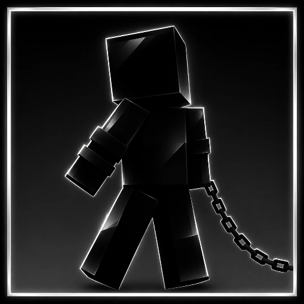

# Physicalist

**0.19.0: walking bots and real get-ups.** `/physicalist ragdoll bots` spawns ragdolls that walk after you; blows
make them step back instead of falling; they sit up and rise like a person; the wand holds the chain link you point
at. Active ragdolls step to catch themselves and get back up after a fall. Chains hook onto any limb. Everything
physical has friction. See the [changelog](CHANGELOG.md).

**0.16.4: soft bodies (experimental).** Deformable cars and planes simulated by a native solver on its own thread:
bodies crumple, doors swing on hinges, planes fly with a blade-element propeller, control surfaces and springy wings
that always spring back (only a crash tears one off). Off by default — set `experimental.softBodies = true` in the
config. Other mods can build and drive soft bodies through `dev.physicalist.soft.SoftApi` (road wheels with
suspension and tyres, terrain, impulses, teleports with rotation). See the [soft-body guide](docs/SOFT_BODIES.md)
and the [changelog](CHANGELOG.md).

**0.9.0: physical chains, player tug-of-war and articulated ragdolls.**
[Controls and API](docs/CHAINS.md).

**0.7.0 — Major physics update.** Built-in assemblies and player ragdolls now
use a shared Rapier3D native scene on Windows x86-64, with persistent compound
colliders, joint/contact solving, CCD, sleeping and cached terrain. The Java
backend remains available for compatibility. See the [new architecture and integration guide](docs/PHYSICS_0_7.md)
or [подробное руководство на русском](docs/ru/PHYSICS_0_7_RU.md).

**Website:** https://sonima-modmaker.github.io/physicalist-library/

Physicalist is a standalone physics mod and API for **Minecraft 1.21.1** on
**NeoForge 21.1.219 and newer 21.1.x patches**. It provides compound collision, collision-driven
aerodynamics, hinges, and a server-side rigid-body step for other mods.
The mod also includes creative-mode tools for trying the physics
without writing an adapter first.

Installing this JAR alone does **not** replace the physics of every Minecraft
entity. A vehicle mod must pass its model geometry and motion through the API.

## Start here

| Goal | Guide |
|---|---|
| Shared native scenes and companion-mod migration | [0.7 architecture](docs/PHYSICS_0_7.md), [JNI ABI](docs/NATIVE_ABI.md), [validation](docs/VALIDATION_0_7.md) |
| Install the mod or build from source | [Installation](docs/INSTALL.md) |
| Integrate vehicles or projectiles | [API and example adapter](docs/API.md) |
| Soft bodies: deformable vehicles, planes, the `SoftApi` | [Soft-body guide](docs/SOFT_BODIES.md) |
| Tune lift, drag, contact and hinges | [Configuration reference](docs/CONFIG.md) |
| Diagnose loading and physics problems | [Troubleshooting](docs/TROUBLESHOOTING.md) |
| Elastic joints, ragdolls and profiling | [Developer guide](docs/ELASTICITY.md) / [Русское руководство](docs/ru/ELASTICITY_RU.md) |
| Read the previous Russian documentation | [Russian documentation (older version)](docs/ru/INSTALL_RU.md) |

The built mod is `build/libs/physicalist_library-<version>.jar`. The `-sources.jar`
file is for development and must not be installed as the playable mod.

## What's included

| Component | Purpose |
|---|---|
| `CompoundCollision` | Contacts between oriented boxes and swept thin-part collision |
| `AutoAerodynamics` | Lift, fall drag and torque inferred from thin collision volumes |
| `Aerodynamics` | Manual lift/drag model for guided or specialized vehicles |
| `PhysicalistSimulation` | One server-side step for a compound physical body |
| `PhysicsBody` | Vehicle adapter interface: shape, pose, mass and angular velocity |
| `Hinge` / `ContactHinge` | Joint motion and contact-driven folding |
| `PhysicalistBodies` | Registry of currently simulated bodies for tools and commands |
| `PhysicalBlockEntity` | One movable rigid body assembled from selected world blocks and their voxel collision shapes; supported bodies settle and sleep |
| `PhysicalistExternalCollisions` | Optional moving-world collision providers, including Sable integration supplied by Create: The Air War |

The creative tab **Physicalist** contains a **Physics Wand**, **Block
Assembler**, and **Physical Entity Deleter**. Hold right click with the wand
while aiming at a physical entity to drag it. Scroll to move the held body
closer or farther away; hold Tab and move the mouse to rotate it without
turning the camera. With the assembler, right click
two opposite corners to turn the selected blocks into **one** physical entity;
sneak-right-click clears the first corner. The assembled body retains each
block's voxel collision, rotates from off-center impacts, and can be pushed by
other entities. Players can stand on its collision parts and push its sides;
resting bodies settle instead of receiving a new impulse on every contact.
Client interpolation smooths the movement of assembled bodies. External
collision providers can receive normal and friction reaction impulses, so a
physical body can push a moving Sable ship through an integration adapter.
F3+B draws its collision parts as green outlines. Aim the
deleter and right click to remove a physical entity. These are creative-mode
tools. A selection is limited to 128 blocks, a 16-block span per axis, and
512 voxel collision boxes. Blocks with block entities or fluid states are
rejected so their data is not lost.

Operators can use `/physicalist list`, `/physicalist select <id>` or
`/physicalist select look`, `/physicalist info`, `/physicalist scale <factor>`,
`/physicalist delete`, `/physicalist block <x> <y> <z>`,
`/physicalist assemble <x1> <y1> <z1> <x2> <y2> <z2>`, and
`/physicalist spawn <block_id> <x> <y> <z>`. The `block` command converts an
existing world block, `assemble` creates one rigid body from a selected region,
and `spawn` creates a physical copy without removing one.
Scaling is available for entities that implement `PhysicalistScalable`. The
library's physical block does; other mods can opt in explicitly so that both
their renderer and collision geometry scale together.

The wand can grab every live body stepped through `PhysicalistSimulation`.
Mods using individual math classes without that simulation can expose their
bodies through `PhysicalistBodyProvider`. This distinction avoids claiming
control over unrelated entities or silently modifying their flight controller.

The server solver checks the swept route once per tick and skips collision
substeps when the complete route is clear. Near blocks it retains swept
thin-part checks; a block destroyed by an impact invalidates the cached route.
The oriented-box contact math also avoids most temporary allocations.

## Vehicle integrations

Create: The Air War uses the library's collision, aerodynamics and hinge math.
Its current library-compatible build also exposes active rockets and debris to the
Physicalist Wand, Deleter and `/physicalist` commands through a body adapter.
The wand applies impulses through Create: The Air War's flight solver, and
F3+B remains drawn by that mod so collision outlines are not duplicated.
Its Sable bridge supplies the library's assembled blocks with moving-ship
collision and an opposing force on the ship. Install matching current builds
of both mods for this behavior.
It still owns weapon guidance, engines, explosions, debris, chunk loading and
its own flight adapter. Its current weapons use the manual aerodynamic path;
the new geometric auto-aero mode is available to vehicle adapters that call
`PhysicalistSimulation` or `AutoAerodynamics.step`.

**Immersive Vehicles Refurbished** is a planned integration target. There is
no IVR adapter or runtime dependency in this repository yet, so installing
Physicalist does not alter its vehicles. The projects are independent.

## Boundaries

- The generic simulation handles block collisions and optional moving-world
  providers. The built-in block assembly also responds to nearby entities;
  vehicle adapters still own their own passenger behavior.
- Swept collision is continuous for translation; fast rotation still needs
  substeps.
- The library does not issue chunk tickets or synchronize arbitrary adapter
  state. The vehicle mod owns persistence and networking for its own bodies.
- An impact callback reports the contact; explosions, damage and sounds belong
  to the vehicle mod.

## Verification and license

The build and server-test matrix covers NeoForge 21.1.219, 21.1.251 and 21.1.265. The standalone
`verification/LibraryPhysicsTest.java` checks manual and geometric aero,
asymmetric wings, mass, fall drag and thin-part collision.
`verification/CollisionParityTest.java` compares 20,000 randomized oriented
contacts and swept contacts against the previous solver. Twenty-one server GameTests
check persistence, assembly, collision-part selection, settling and waking,
the clear-path shortcut and a fast impact on thin bars.
Runtime TPS should still be measured in a real world before a production modpack.

Source code is **GPL-3.0-only**. `LICENSE` and `NOTICE` are included in the
project and built JAR. The project began from the
[NeoForge MDK](https://github.com/NeoForgeMDKs/MDK-1.21.1-NeoGradle).

## Elastic physics and test ragdolls (0.6)

Physicalist now includes mass-aware rigid states, XPBD elastic distance joints and ball sockets, damping, break forces, swing limits, a spatial obstacle index and opt-in solver counters. Existing adapters remain source-compatible.

Try `/physicalist ragdoll [online player]` to spawn a separate six-part skin dummy, then grab it with the physics wand. Add `active` (`/physicalist ragdoll active`, `/physicalist ragdoll mob minecraft:villager active`) for a ragdoll that stands and steps to keep its balance when shoved, and `/physicalist ragdoll ondeath true` to turn dying mobs into ragdolls. Other mods: `PhysicalistRagdolls.spawn(entity, push, active)` and `PhysicalistRagdolls.deathPush(entity, push)`. Use `/physicalist stats start` and `/physicalist stats` to inspect solver work.

Read the detailed [elasticity and developer guide](docs/ELASTICITY.md) or the [Russian guide](docs/ru/ELASTICITY_RU.md) for units, integration examples, persistence, performance and limitations.
